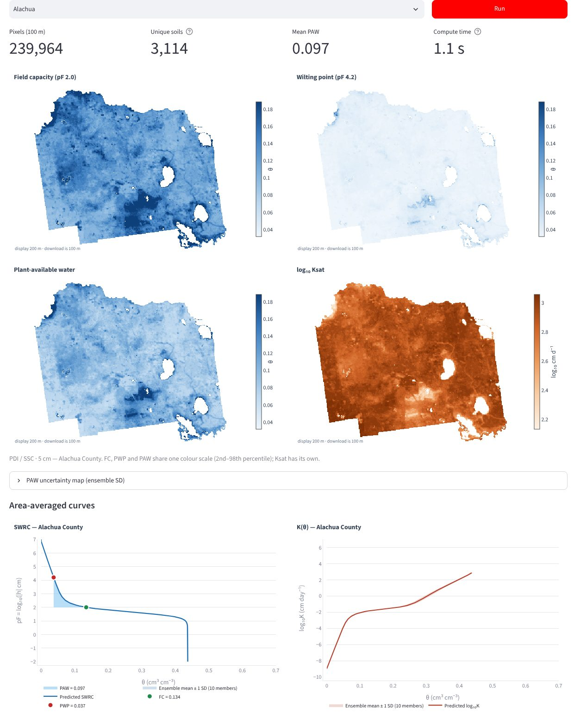
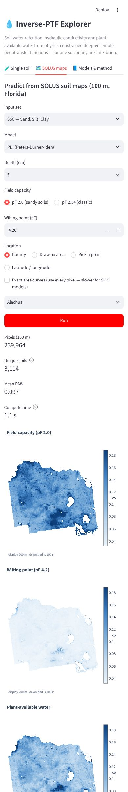

# Inverse-PTF Explorer

**Soil-water retention, hydraulic conductivity and plant-available water from physics-constrained deep-ensemble pedotransfer functions — for a single soil or any area of Florida.**

[](https://github.com/nikhilrajdeep/PTF_Retention_Curve/actions/workflows/tests.yml)
[](LICENSE)
[](LICENSE-DATA.md)
[](requirements.txt)

The app runs in any modern browser — phone, tablet or laptop. Give it sand, silt and clay (and, optionally, bulk density and organic carbon) and it returns the full soil-water retention curve (SWRC), the unsaturated hydraulic conductivity curve K(θ), saturated hydraulic conductivity (Ksat), field capacity (FC), permanent wilting point (PWP) and plant-available water (PAW), each with an uncertainty band. On the map tab it does the same for every 100 m pixel of a county, a drawn area or a single point, using the SOLUS soil-property maps.

| Raster Prediction tab (laptop) | Phone |
|---|---|
|  |  |

---

## What the app does

| Tab | Input | Output |
|---|---|---|
| **Single soil** | Sand, silt, clay (%), and bulk density (g cm⁻³) and/or organic carbon (%) when the chosen model uses them, plus depth | SWRC and K(θ) curves with an ensemble band, FC, PWP, PAW, Ksat, and the table of fitted hydraulic parameters (θr, θs, α, n, Ksat, and τ or ω, λ). CSV download. |
| **Raster Prediction** | A county, a drawn polygon/rectangle, a clicked point, or a latitude/longitude; one of five depths (5, 15, 30, 60, 100 cm) | Maps of FC, PWP, PAW and Ksat, uncertainty maps (ensemble SD) for PAW and log₁₀Ksat, area-averaged SWRC and K(θ) with PAW shaded, and an AOI summary table. GeoTIFF (zip) and CSV downloads. |
| **Models & method** | — | A short description of the models and the independent test-set accuracy of all 12 ensembles. |

The user chooses an **input set** and a **model family**; the app loads the matching ensemble and asks only for the inputs that model was trained on.

## Models

The pedotransfer functions are *inverse*: a neural network predicts the **parameters** of a closed-form soil hydraulic model, and the physical equations then generate the curves. Every predicted curve is therefore smooth, monotonic and physically bounded.

| Family | Retention θ(h) | Conductivity K(h) | Predicted parameters |
|---|---|---|---|
| **Classic VG** | van Genuchten (1980), m = 1 − 1/n | van Genuchten–Mualem | θr, θs, α, n, Ksat, τ |
| **Enhanced VG** | van Genuchten with a dry-end correction, so that water content reaches zero at pF 6.8 | van Genuchten–Mualem | θr, θs, α, n, Ksat, τ |
| **PDI** | Peters–Durner–Iden: capillary + adsorbed (film) water | capillary + film flow | θr, θs, α, n, Ksat, ω, λ |

Each family is trained with four input sets — **SSC** (sand, silt, clay), **SSCBD** (+ bulk density), **SSCOC** (+ organic carbon) and **SSCBDOC** (+ both) — giving **12 ensembles of 10 networks**. Depth is an input to every model.

**Independent test-set accuracy** (point estimates; 95 % cluster-bootstrap intervals are in each `models/ptf_model_bundle/<RUN>/test_bootstrap_metric_CIs.csv` and in the app):

| Model | Inputs | θ RMSE (cm³ cm⁻³) | θ R² | log₁₀K(h) RMSE | log₁₀Ksat RMSE | log₁₀Ksat R² |
|---|---|---|---|---|---|---|
| Classic VG | SSC | 0.073 | 0.78 | 0.61 | 0.56 | 0.26 |
| Classic VG | SSCBD | 0.054 | 0.87 | 0.54 | 0.53 | 0.35 |
| Classic VG | SSCOC | 0.057 | 0.86 | 0.59 | 0.54 | 0.28 |
| Classic VG | SSCBDOC | 0.052 | 0.89 | 0.53 | 0.51 | 0.35 |
| Enhanced VG | SSC | 0.072 | 0.78 | 0.79 | 0.50 | 0.37 |
| Enhanced VG | SSCBD | 0.053 | 0.88 | 0.62 | 0.48 | 0.44 |
| Enhanced VG | SSCOC | 0.057 | 0.86 | 0.65 | 0.53 | 0.29 |
| Enhanced VG | SSCBDOC | 0.050 | 0.90 | 0.65 | 0.49 | 0.39 |
| PDI | SSC | 0.071 | 0.79 | 0.66 | 0.50 | 0.37 |
| PDI | SSCBD | 0.053 | 0.88 | 0.65 | 0.45 | 0.49 |
| PDI | SSCOC | 0.056 | 0.87 | 0.65 | 0.48 | 0.39 |
| PDI | SSCBDOC | 0.051 | 0.89 | 0.65 | 0.43 | 0.52 |

## Methodology (brief)

1. **Training data.** Measured soil-water retention and hydraulic conductivity data were split into development and independent test sets by `Group_ID` (a grouped split), and all test metrics are computed on the held-out groups.
2. **Network.** A fully connected network (2–4 hidden layers; ReLU or tanh; width, depth, learning rate and loss weights tuned with Optuna) maps min–max-scaled inputs to raw outputs. Each raw output passes through a scaled sigmoid onto its physical range (for example, θs is kept above θr + a minimum gap, and α, n and Ksat are bounded in log space). The network cannot produce a non-physical parameter set.
3. **Physics layer.** The bounded parameters feed the retention and conductivity equations of the chosen family, evaluated in log space for numerical stability. The loss is computed on the curves (θ on the SWRC, log₁₀K on K(h), and log₁₀Ksat), with a Huber penalty, extra weight on the dry end, and a mix of point-wise and curve-wise normalisation. A weak prior towards curve-fitted parameters controls equifinality where it is used.
4. **Uncertainty.** Ten networks with different random seeds form a deep ensemble. The app shows the ensemble mean ± 1 SD (about 68 %); this is model (epistemic) spread, not a calibrated predictive interval. Test metrics use a 1000-repetition cluster bootstrap over `Group_ID`.
5. **Inputs at prediction time.** Sand, silt and clay are rescaled to sum to 100 % per soil/pixel (the models were trained on closed compositions; SOLUS layers are not). The app reports what fraction of an area falls outside the training range of each input.
6. **Derived quantities.** FC is θ at pF 2.0 (sandy soils, default) or pF 2.54; PWP is θ at pF 4.2 (adjustable); PAW = FC − PWP. Uncertainty maps show, for every pixel, the SD of PAW and of log₁₀Ksat across the 10 ensemble members.

## Spatial data

SOLUS 100 m soil-property maps for Florida (Nauman et al., 2024) — sand, silt, clay, bulk density and soil organic carbon at 5, 15, 30, 60 and 100 cm — are stored in [`data/solus_cog/`](data/solus_cog) as **Cloud-Optimized GeoTIFFs** (COGs):

* all 25 layers snapped to **one** 100 m grid (EPSG:5070). The source layers already share pixel size and their origins differ by whole pixels, so this is an exact integer-offset copy with no resampling;
* native integer storage, 512 × 512 internal tiles, DEFLATE compression, internal overviews;
* the physical scale factor is written into each band's metadata (BD × 0.01 → g cm⁻³, SOC × 0.001 → %) and listed in `catalog.json`, so it never has to be guessed.

`tools/build_cogs.py` rebuilds them from the original GeoTIFFs and leaves those untouched.

## Run it

**Locally (Windows, macOS, Linux)**

```bash
git clone https://github.com/nikhilrajdeep/PTF_Retention_Curve.git
cd PTF_Retention_Curve
python -m venv .venv && .venv\Scripts\activate        # macOS/Linux: source .venv/bin/activate
pip install -r requirements.txt
streamlit run app.py
```

The app opens at `http://localhost:8501`. Any phone or tablet on the same network can use `http://<your-computer-ip>:8501`.

**Free public hosting (Streamlit Community Cloud)**

1. Sign in at <https://share.streamlit.io> with GitHub.
2. *Create app* → *Deploy a public app from GitHub* → repository `nikhilrajdeep/PTF_Retention_Curve`, branch `main`, main file `app.py`, Python 3.12.
3. Deploy. The app gets a public `*.streamlit.app` address that works on any device.

**Docker** (Hugging Face Spaces, Render, Google Cloud Run, a lab server)

```bash
docker build -t ptf-explorer .
docker run -p 8501:8501 ptf-explorer
```

**Configuration** (environment variables, all optional)

| Variable | Default | Purpose |
|---|---|---|
| `PTF_DATA` | `data/solus_cog`, else `../Soil_Properties_Maps_COG` | Folder **or https URL** of the COGs. GDAL reads COG tiles over HTTP range requests, so the data can live on any static host (S3, Zenodo, a GitHub release) without being downloaded. |
| `PTF_MODEL_DIR` | `models/ptf_model_bundle` | Folder with the 12 exported ensembles |
| `PTF_CURVE_PIXELS` | `20000` | Unique-soil threshold for exact area curves |

## Repository layout

```
app.py                       Streamlit app (3 tabs, responsive layout)
ptf_engine/
  core.py                    networks in NumPy, physics (NumPy + Numba), ensemble predictor
  raster.py                  COG windowed reads, AOI masks, exact de-duplication, GeoTIFF export
  plots.py                   Plotly figures (SWRC, K(θ), maps)
models/ptf_model_bundle/     12 ensembles: original .pt checkpoints + exported weights.npz/engine.json,
                             scalers, configs, test metrics
data/solus_cog/              25 SOLUS COGs (5 variables × 5 depths) + catalog.json
data/counties/               Florida county boundaries (EPSG:5070 for masks, WGS84 for display)
tools/build_cogs.py          original GeoTIFFs → aligned COGs
tools/export_models.py       PyTorch checkpoints → torch-free weights
tools/benchmark.py           timing + pixel-by-pixel comparison with the original app
tests/                       equivalence tests against the original PyTorch code
legacy/                      the original ptf_core.py and Streamlit app, kept for reference/tests
```

## Citation

If you use the app, the code or the trained models, please cite this repository (see [`CITATION.cff`](CITATION.cff) — GitHub shows a *Cite this repository* button) and the SOLUS data:

> Nauman, T. W., Kienast-Brown, S., Roecker, S. M., Brungard, C., White, D., Philippe, J., & Thompson, J. A. (2024). Soil landscapes of the United States (SOLUS): developing predictive soil property maps of the conterminous United States using hybrid training sets. *Soil Science Society of America Journal*. https://doi.org/10.1002/saj2.20769

## Licence

* **Code** — [MIT](LICENSE).
* **Trained models** — [CC BY 4.0](LICENSE-DATA.md): free to use and adapt with credit.
* **SOLUS data** — public domain (USDA); repackaged as COGs with values unchanged.

## Author

**Nikhil Raj Deep** — PhD candidate, Soil, Water, and Ecosystem Sciences, University of Florida.
Questions and issues: please open a [GitHub issue](https://github.com/nikhilrajdeep/PTF_Retention_Curve/issues).
